# LatticeProcessing

LatticeProcessing is a library for efficiently processing lattice light-sheet data using CPU/GPU parallelization with an emphasis on particle tracking to measure transcriptional dynamics. 

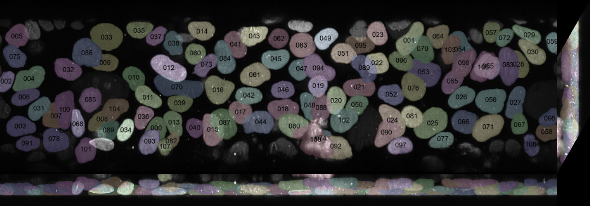


This library is written as an editable ```pipeline``` package with scripts for an analysis pipeline and importable functions for tools like deskewing and deconvolution. See ```example/main.ipynb``` to explore and tune such methods.


## Features

### Deskewing (with coverslip transform)

Lattice light-sheet acquistions can be efficiently transformed to isotropic volumes. This library makes use of CuPy's ```ndimage.affine_transform``` to efficiently perform the transformation on GPUs.

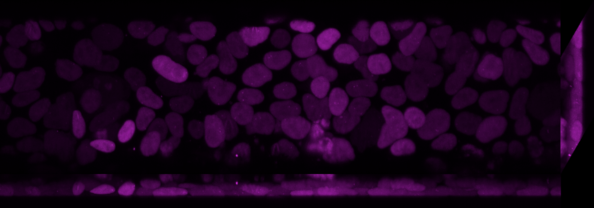

See ```pipeline.utilities.deskewing``` for more information.


### Deconvolution

The library performs iterative Richardson-Lucy deconvolution with a measured PSF (from beads) on a GPU. Total-Variation regularization can also be added to remove noise.

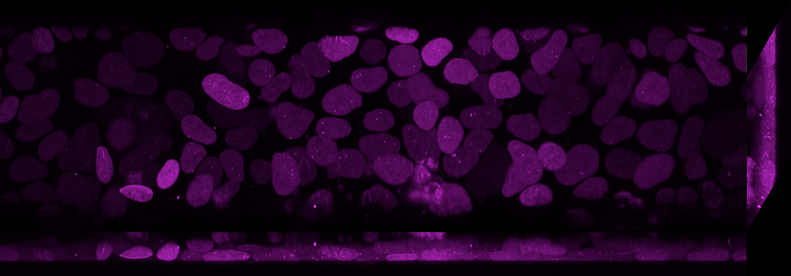

Functionality with ```pipeline/beads.py``` allows one to average bead localizations to generate a kernel for deconvolution.

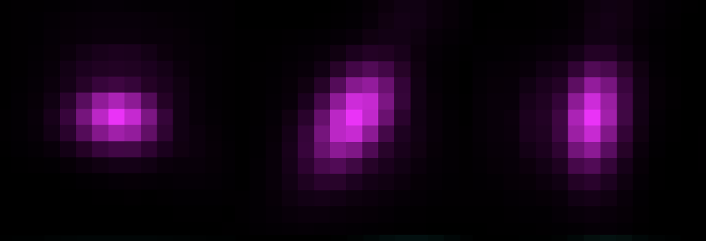

See ```pipeline.utilities.deconvolution``` for more information.


## Installation

### Environment

The library has been tested on Linux system  with ```python``` 3.10 to 3.14. To make an environment using ```conda```, one can use the following commands.
```
conda create --name lattice python=3.14
conda activate lattice
```

### Get the library
The following blocks with will walk through the library installation. 
```bash
git clone git@github.com:ahansenlab/LatticeProcessing.git
cd LatticeProcessing
```

### Install the library
It is best to install the library as the editable ```pipeline``` package to run, evalute, and modify each of the modules for a specific project. 

```bash
mkdir .install  # hide the build here
```

```bash
pip install -e .[CUDA]  # see below
```

Support for (NVIDIA) GPUs is enabled through CuPy. In order to work properly, this dependency must be configured to the CUDA Toolkit version. For example, an environment with CUDA 12.9 would use the following.
```bash
pip install -e .[12]
```

Use ```nvcc --version``` if you are unsure which CUDA is available. Should issues with CuPy persist, you may need to set your environment variables such that CuPy can see CUDA. See [here](https://docs.nvidia.com/cuda/cuda-installation-guide-linux/#post-installation-actions) for more information.

## Pipeline modules

### How to run

The pipeline is mainly organized into scripts representing a processing module that can be run either within Python or on the command line.

#### Run within Python
```py
from pipeline import module

module.run(file="file.czi", config="config.yaml")
```

#### Run on command-line
```bash
python pipeline/module.py --file file.czi --config config.yaml
```

#### All options
Note that not every option will be used by a module.
| Keyword (--flag)             | Description                  |
| ---------------------------- | ---------------------------- |
| file (--file / -f)           | Input (CZI) file             |
| beads (--beads / -b)         | Path to (TXT) file of beads  |
| psf (--psf / -p)             | Point spread function (H5)   |
| directory (--directory / -d) | Path for pipeline outputs    |
| config (--config / -c)       | Path to (YAML) config        |
| start (--start / -s)         | Starting frame               |
| end (--end / -e)             | Ending frame (exclusive)     |
| nproc (--nproc / -n)         | Number of CPU processes      | 
| gpus (--gpus / -g)           | Number of GPU devices        |
| mode (--mode / -m)           | Mode for pipeline module     |
| other (--other / -o)         | Additional input for testing |
| force (--force / -f)         | Ignores overwrite handling   |

### Modules

#### ```beads.py```

**Mode:** ```finding```

Detects beads (in all movies) for intensity measurements and links between channels for chromatic aberration corrections. Can be used to measure PSFs for deconvolution.

**Mode:** ```fitting```

Computes (for a single movie) a PSF for laser intensity corrections and fits a low-order polynomial to channel offsets for applying chromatic aberration corrections.

#### ```segmentation.py```

Reads and deconvolves each frame then finds nuclei. Nuclei are segmented through a series of filters then bounding boxes (and masks) are saved for all nuclei.

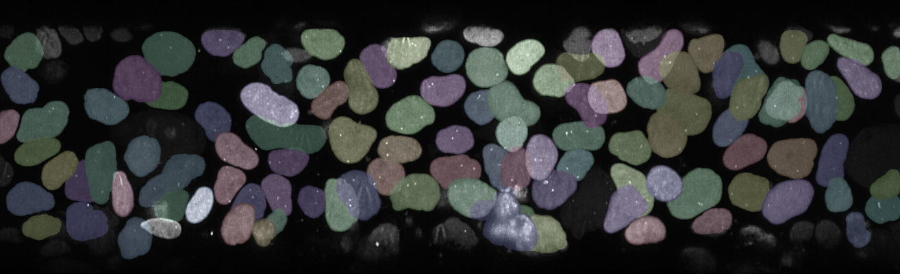

#### ```detection.py```

This detects features (dots) within all tracked nuclei using a range of Laplacian of Gaussian (LoG) filters for size selection.

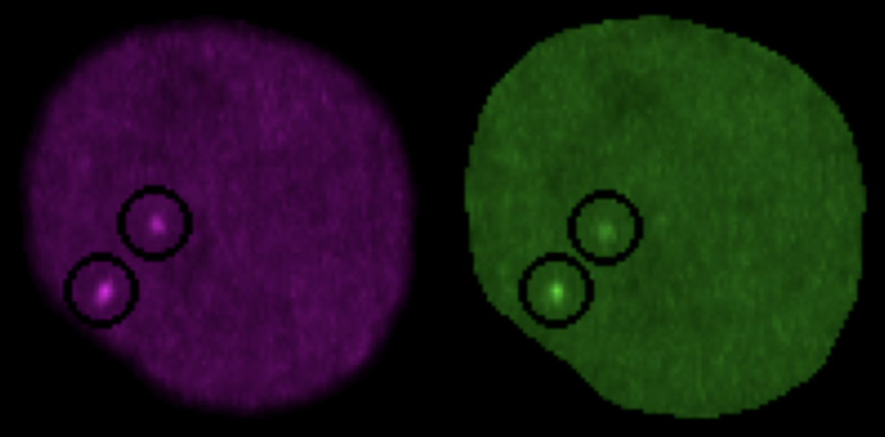

#### ```tracking.py```

**Mode:** ```nuclei```

Tracks nuclei based on centroid positions throughout all segmented frames.

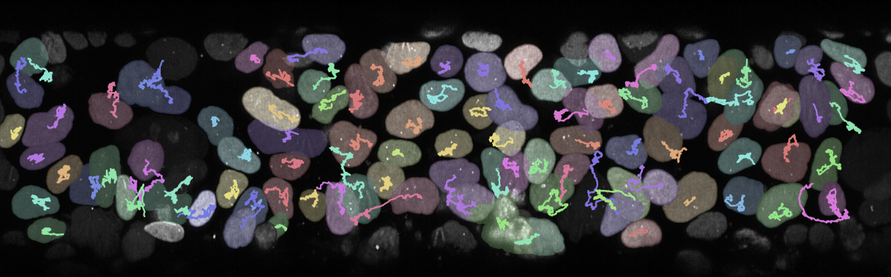

**Mode:** ```features```

Links detected features within a nucleus to make tracks of feature positions across channels. (add figure)

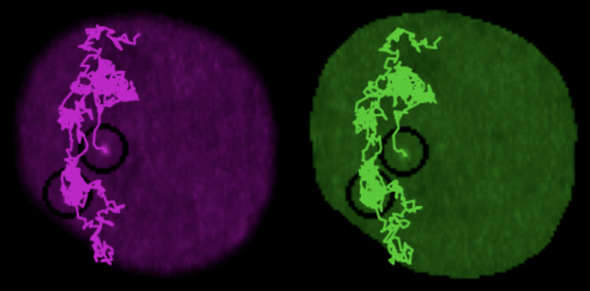

#### ```measuring.py```

This module is intended to measure and quantify tracked features within each nucleus. Currently, it is configured to measure distances between DNA loci and quantify nascent transcription. 

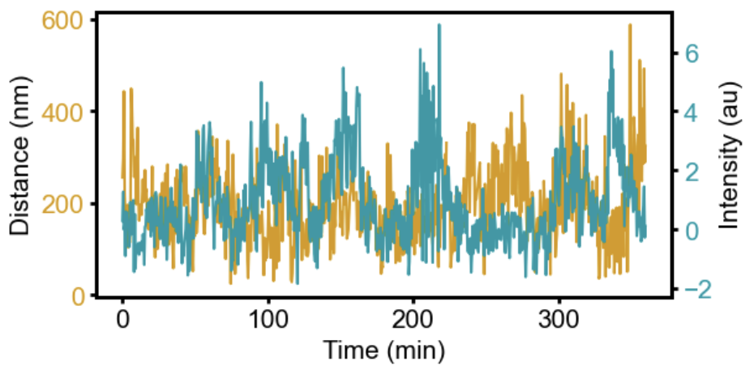

#### ```movies.py```

Makes movies of pipeline outputs across multiple modes.

**Mode:** ```labels```

Shows all tracked nuclei on a maximum intensity projection (MIP) of the segmentation channel.

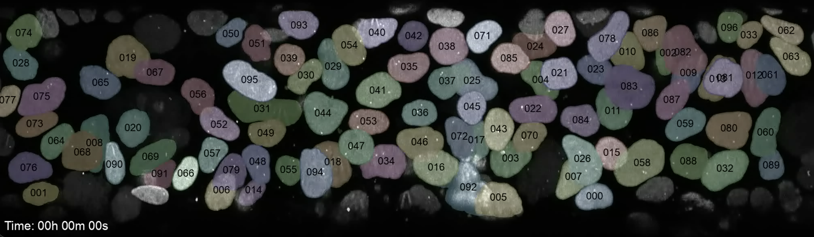

**Mode:** ```channels```

Makes a MIP of the signal in tracked nuclei for all channels (including a merge).

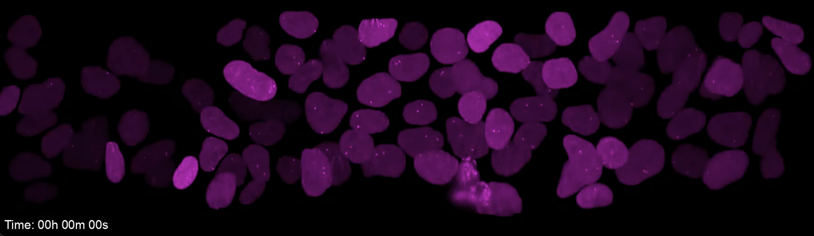

**Mode:** ```nuclei```

For each tracked nucleus, makes MIPs along each axis and channel.

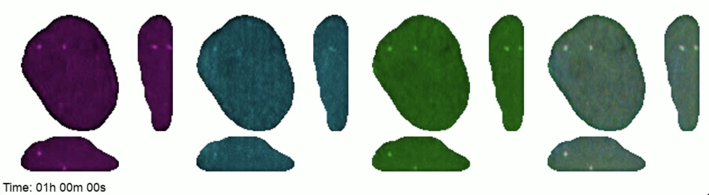


**Mode:** ```evaluate```

Same as above but adds a trace over every tracked feature.


